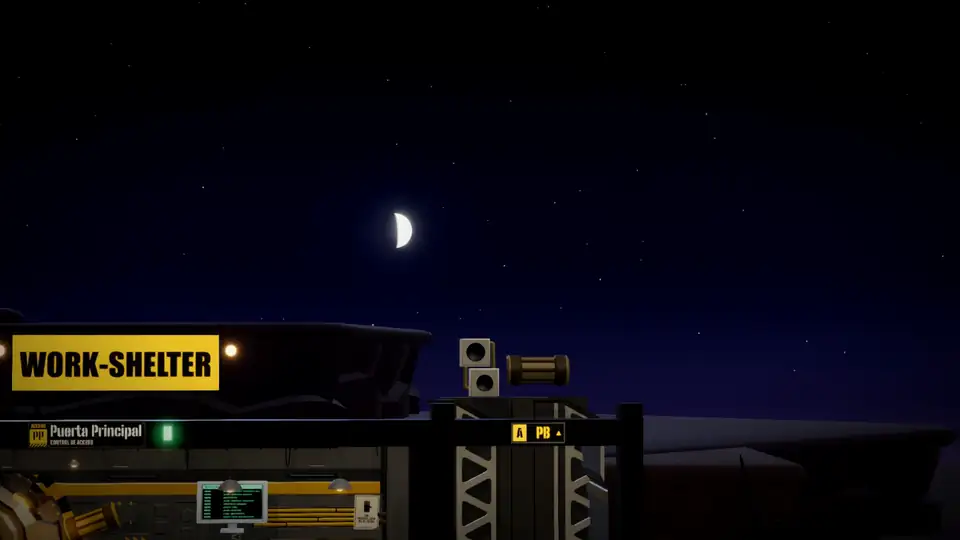

# work-shelter

<p align="center">
  <a href="docs/media/trailer.mp4"></a>
  <br>
  <a href="docs/media/trailer.mp4"><b>▶ Ver el tráiler completo</b></a> (2 min, con sonido)
</p>

**Un refugio subterráneo jugable que es tu interfaz de trabajo sobre [Claude Code](https://docs.claude.com/claude-code).**
Cada repositorio es una sala excavada en la roca y sus habitantes son sesiones reales de Claude Code en esa carpeta.
Tú eres el Supervisor: recorres pasillos y ascensores, hablas con los habitantes, apruebas permisos, abres terminales
y lees el correo, los chats y el calendario sin salir del refugio.

> *English summary:* work-shelter is a Fallout-Shelter-style 3D management game (three.js + Electron, macOS) that is
> really a UI for real Claude Code sessions: each repo is a room, each inhabitant is a Claude Code session, talking is
> working. It runs entirely on your Mac with your existing Claude Code login (no API keys, no telemetry). The game and
> its docs are in Spanish. **It is an opinionated first proposal, not a product**: fork it and make it yours. Some
> parts (the shooting gallery and the in-game economy) are deliberately left as an unfinished first iteration.
> Install as a macOS app: `curl -fsSL https://raw.githubusercontent.com/DavidTorrijos/work-shelter-public/main/instalar.sh | bash`.

- **Todo en tu Mac.** El servidor solo escucha en `127.0.0.1`, no hay telemetría y el juego no usa claves de API ni
  inferencia propia: los habitantes trabajan con **tu** Claude Code instalado, con tu sesión, tus ajustes, tu
  `CLAUDE.md`, tus hooks y tus servidores MCP.
- **Es un juego de verdad**: habitantes con rutina y personalidad, ascensores, cultivos, galería de tiro, tienda,
  peluquería para cambiar de aspecto… y todo se maneja con el teclado.
- **Funciona sin configurar nada**: en el primer arranque el refugio trae cuatro repos de ejemplo y las
  integraciones en modo DEMO.

## Qué es esto (y qué no)

work-shelter es **una propuesta inicial**: una forma posible de trabajar con agentes de código si, en vez de una
lista de pestañas, tuvieras un sitio por el que moverte, con gente dentro haciendo cosas. Funciona de punta a punta,
pero no es un producto ni pretende serlo:

- **No hay hoja de ruta ni promesa de mantenimiento.** Lo que hay es lo que es. Si algo no te encaja, cámbialo.
- **Hazlo tuyo.** Haz un fork y llévalo a donde quieras: otro estilo, otro juego encima, otras integraciones, otro
  agente que no sea Claude Code, quitar la mitad de las cosas. La licencia es MIT precisamente para eso.
- **Está pensado para que lo cambie un agente.** [`AGENTS.md`](AGENTS.md) describe la arquitectura para Claude Code y
  Codex, y el propio refugio tiene una sala, el **Puente de Mando**, cuyo habitante trabaja sobre el repo del juego:
  le pides un cambio desde dentro y lo aplicas sin cerrar nada.
- **Las decisiones son opinables.** Todo en español, solo macOS, estética de refugio, integraciones de solo lectura…
  Son elecciones de esta versión, no principios del proyecto (salvo las de privacidad y seguridad, que conviene
  conservar: ver más abajo).

### Sin pull requests ni issues

Se publica para que lo uses y lo cambies, no como proyecto comunitario: **no leo ni acepto pull requests ni issues, y
no hay soporte**. No es nada personal, es la única forma de compartirlo sin que se convierta en un segundo trabajo. Si
lo mejoras, publícalo en tu fork y cuéntalo por ahí para que otros lo encuentren: será un placer que circule.

### Lo que está a medias

Dos partes del juego son **una primera iteración sin terminar** y se dejan así a propósito, abiertas para quien las
quiera rehacer a su manera:

- **La galería de tiro** (`web/src/mundo/tiro.ts`, `RondaTiro` en `web/src/ui/Actividades.tsx`). La mira solo se
  mueve en horizontal (la altura es fija, la de la fila de blancos) y el acierto se decide comparando la `x` en
  pantalla de la mira con la de cada blanco, con una tolerancia; no hay rayo ni profundidad. Se nota: hay tiros que
  deberían entrar y no entran, y al revés. Los puntos los calcula el cliente y el servidor solo los acota
  (`juego.tiro` en `server/juego.ts`). Ideas obvias: mira libre en dos ejes con `Raycaster` contra los blancos,
  blancos a distintas alturas y distancias, y que el servidor reciba los disparos en vez del resultado.
- **La economía** (`server/juego.ts`, `shared/catalogo.ts`). La moneda es la chatarra: cada tarea terminada por un
  habitante da 10–50 y a veces una pieza para la guía de campo; las llamadas a herramientas hacen crecer los cultivos;
  la galería, la radio y el generador dan un poco más; y en la tienda se gasta en accesorios, armas y semillas. Las
  piezas existen, los números cuadran y el servidor es la autoridad, pero **no se entiende bien para qué sirve y es
  sosa**: no hay progresión, ni nada que desbloquear que importe, ni relación clara entre lo que trabajas y lo que
  obtienes. Está para que alguien le dé sentido (o la quite: el resto del refugio no depende de ella).

Si rehaces cualquiera de las dos, el resto del juego solo las toca por las acciones `juego.*` del protocolo y el
estado `jugador` del refugio.

### ¿Y con Codex?

Hoy cada habitante es una sesión de **Claude Code**. Codex ya puede trabajar *sobre* el código del juego (lee
[`AGENTS.md`](AGENTS.md), igual que Claude Code), pero no puede *ser* un habitante: eso está sin hacer, y es justo el
tipo de cambio para el que está pensado el Puente de Mando. La forma más cómoda es pedírselo a **Néstor**, su habitante
(planta -1), como le pedirías cualquier otra cosa. Por ejemplo:

> Quiero que los habitantes puedan ser sesiones de Codex además de Claude Code, eligiendo el agente por sala. Antes de
> tocar nada, lee AGENTS.md, haz inventario de todo lo que hoy depende de Claude Code y proponme un plan por fases.
> La primera fase: una conversación con Codex en una sala, con sus permisos pasando por el diálogo del juego. Claude
> Code tiene que seguir funcionando exactamente igual, y Codex debe usar mi propia sesión (nada de claves de API).

Algunos consejos:

- **Ve por fases** y prueba cada una antes de seguir: deja que te proponga el plan, discútelo y aprueba fase a fase.
  Al acabar cada una, «Aplicar los cambios del juego» (interfaz) o «Reiniciar el juego» (servidor) desde el propio
  refugio.
- **Haz un commit antes de cada fase** para poder volver atrás si el refugio deja de arrancar. Si se rompe tanto que no
  puedes entrar, abre Claude Code o Codex en una terminal en la carpeta del juego y pídeselo desde ahí.
- **Recuérdale lo que no debe perder**: que nada se envíe fuera de tu Mac salvo al propio agente, que los permisos los
  sigas aprobando tú y que las conversaciones se puedan retomar fuera del juego («salir a la superficie»).
- Necesitas Codex instalado y con tu sesión iniciada, igual que Claude Code.

## Requisitos

- macOS (Apple Silicon o Intel). El dictado por voz necesita macOS 26; todo lo demás, cualquier macOS reciente.
- [Claude Code](https://docs.claude.com/claude-code) instalado y con sesión iniciada (`claude` y luego `/login` en una
  terminal). Los habitantes consumen los límites de tu plan, como si trabajaras en la terminal.
- Opcional: [`gh`](https://cli.github.com) con sesión iniciada (pull requests, contribuciones y notificaciones de
  GitHub) e iTerm (para «salir a la superficie»; si no está, se usa Terminal).

## Instalación

Pega esto en una terminal:

```bash
curl -fsSL https://raw.githubusercontent.com/DavidTorrijos/work-shelter-public/main/instalar.sh | bash
```

Tarda unos minutos la primera vez y al terminar tienes **work-shelter en Aplicaciones**, con su icono y fijado en el
Dock; desde entonces se abre como cualquier app. Lo que hace ([`instalar.sh`](instalar.sh), léelo antes si quieres):

- Descarga el juego en `~/.work-shelter-public` (otra carpeta: `SHELTER_CODIGO=/ruta` delante de `bash`). Si macOS no
  tiene git, abre el instalador de sus herramientas de línea de comandos y te pide repetir el comando al acabar.
- Usa Node 22 o superior; si no lo encuentra, descarga uno portátil para el juego (comprobando su suma oficial).
- Instala las dependencias (`npm ci`) y la ventana del juego (Electron), descarga el material artístico CC0 (unos
  100 MB, fijado por commit) y compila la interfaz.
- Crea `/Applications/work-shelter-public.app`, la fija en el Dock y la abre. Para no tocar el Dock:
  `… | bash -s -- --sin-dock`.

No pide contraseña ni instala nada fuera de esas carpetas (si tu usuario de macOS no es administrador y no puede
escribir en `/Applications`: `… | bash -s -- --destino ~/Applications/work-shelter-public.app`). La app no está firmada por ningún
desarrollador: la crea tu propio Mac al instalar, así que macOS la abre sin avisos.

**Poner al día:** vuelve a ejecutar el mismo comando (si has cambiado el código del juego, no lo pisa).

**Desinstalar:** borra `/Applications/work-shelter-public.app` (y quítala del Dock), `~/.work-shelter-public` (el
juego y el estado del refugio), `~/Library/Application Support/work-shelter-public` (repos de ejemplo, carpetas de las
salas especiales y sesiones de los navegadores) y `~/Library/Logs/work-shelter-public`. Las credenciales de las
integraciones están en el llavero (Acceso a Llaveros, busca `work-shelter-public`). Tus repos y tus conversaciones de
Claude Code no se tocan.

### Desde el código

Si vas a cambiar el juego, puedes tenerlo donde quieras:

```bash
git clone https://github.com/DavidTorrijos/work-shelter-public.git work-shelter && cd work-shelter
./shelter                 # prepara lo que falte y abre el juego (Ctrl+C aquí lo cierra todo)
./shelter instalar-app    # o crea la app de Aplicaciones apuntando a esta carpeta (--sin-dock para no tocar el Dock)
```

La app abre el juego de la carpeta desde la que se instaló, así que tus cambios se ven sin reinstalarla: el Puente de
Mando del propio juego los aplica («Aplicar los cambios del juego» o «Reiniciar el juego»). El icono es
`electron/icono/fuente.png`; si lo cambias, `node scripts/instalar-app.mjs --icono` lo prepara de nuevo (necesita
`npx playwright install chromium`).

Cerrar la ventana pide confirmación y para todas las sesiones. Si recargas, no se pierde nada: el servidor espera 20
segundos a que vuelvas antes de parar las sesiones.

## Primer arranque

Eliges el aspecto del Supervisor y el nombre del refugio. El refugio trae:

- **Cuatro salas de ejemplo**, una por clase de proyecto, cada una con un repo público muy conocido que se clona solo
  la primera vez (con su historia reciente) en `~/Library/Application Support/work-shelter-public/ejemplos/`:

  | Sala | Repo | |
  |---|---|---|
  | Estudio (web y Node; donde empiezas) | [`expressjs/express`](https://github.com/expressjs/express) | el framework web de Node |
  | Laboratorio (Python) | [`psf/requests`](https://github.com/psf/requests) | HTTP para humanos |
  | Fundición (Rust y Go) | [`BurntSushi/ripgrep`](https://github.com/BurntSushi/ripgrep) | el buscador de texto |
  | Archivo (sin código) | [`sindresorhus/awesome`](https://github.com/sindresorhus/awesome) | la lista de listas |

  Son la misma escena que le toca a cualquier repo tuyo de ese tipo. Desde el **panel de la sala** (E junto a él)
  puedes **vincularla a un repo tuyo** (la sala y su habitante se quedan; la copia de ejemplo va a la papelera) o
  **retirarla**, y reclutar más repos desde la **Puerta**, que sugiere las carpetas de tu raíz de repos (`~/Sites`,
  `~/Developer`, `~/Projects`, `~/code`… la primera que exista; se cambia en la cámara acorazada).
- **Adaptar la sala al repo** (panel de la sala o ⌘K): su habitante lee el repo y le diseña una escena propia con el
  atrezo del juego (la pieza protagonista, muebles y cachivaches, carteles con lemas, pantallas que escriben solas,
  colores y luz), la mira con una foto, la corrige y te cuenta qué ha montado. Luego le puedes pedir retoques en la
  misma conversación («pon una planta junto a la mesa»), o volver a la escena de serie. La escena son datos que el
  juego valida, nunca código: ver [`docs/decorados.md`](docs/decorados.md).
- Las salas de servicio: el Puente de Mando (el repo del propio juego), la cámara acorazada (integraciones y ajustes),
  comunicaciones, planificación (calendario), logística (Linear), control de versiones (git y GitHub), la puerta,
  hidroponía, discoteca, galería de tiro y Chapa y Pintura (cambiar de aspecto).

## Controles

Todo está en el juego con **F1**, y las teclas de cada cosa se ven en la regleta de arriba.

| Tecla | Qué hace |
|---|---|
| WASD / flechas | andar (mantenidas, corre; Shift corre desde el primer paso); en el rellano, W/S suben y bajan en ascensor |
| E / Enter | hablar, usar un aparato, elegir |
| clic | ir a un sitio; clic en un habitante: ir y hablar |
| rueda, Z, − / = | zoom, vista general, vista de sala |
| M | plano: viaje rápido y reorganización de salas |
| Tab | qué pasa ahora: quién trabaja, quién te espera, avisos, próximo evento |
| Q | ir directo al primer habitante que te espera |
| T | terminal real de la sala (shell sobre PTY) |
| R | cuaderno: transcripción completa de una conversación |
| I | mochila: inventario, guía de campo, tienda y récords |
| N / C / L | ir a comunicaciones, planificación o logística |
| G | cliente de git |
| P | Chapa y Pintura: cambiar el aspecto (tuyo o de un habitante) |
| ⌘K | buscador, desde cualquier sitio: conversaciones, acciones, habitantes y salas |
| Esc | cierra lo abierto; en el refugio, el menú del juego (opciones, atajos, reiniciar, salir) |

En la conversación: Enter envía (Shift+Enter, salto de línea); `/` abre los comandos de Claude Code y `/btw` hace una
pregunta lateral sin interrumpir; Ctrl+C (o `/stop`) para al habitante; ⌘U o arrastrar adjunta archivos; ⌘D dicta
(transcribe macOS en tu Mac, sin red); 1 / 2 / 3 en un permiso: permitir, permitir siempre en la sesión, denegar.

## Qué hay en el refugio

- **Salas de repositorio**: rama, cambios, último commit, habitantes y actividad. Abrir la carpeta en Finder, en el
  editor o en Terminal, ver el historial, retirar la sala.
- **Habitantes**: sesiones reales de Claude Code. Empezar un trabajo (modelo, esfuerzo, modo de permisos, worktree),
  retomar conversaciones de esa carpeta (también las de la terminal), aprobar permisos viendo el comando o el diff
  exacto, contestar preguntas y aprobar planes, interrumpir. Varios trabajos a la vez, cada uno en su pestaña.
- **Ayudantes**: los subagentes aparecen como robots en la sala cuyos archivos tocan.
- **Copias holográficas**: los worktrees, como hologramas de quien trabaja dentro. Integrar o desechar desde su panel.
- **Visitantes**: una sesión de Claude Code abierta en una terminal de esa carpeta se asoma a la sala.
- **Control de Versiones**: cliente de git de todos los repos del refugio (preparar por archivos, bloques o líneas,
  commit, push, ramas, cajón) y, con GitHub conectado en la cámara acorazada, tus pull requests y tu matriz de
  contribuciones (si no, DEMO).
- **Puente de Mando**: el repo del propio juego. Su habitante evoluciona el juego desde dentro; «Aplicar los cambios
  del juego» recompila la interfaz sin cortar las sesiones.
- **Discoteca**: la cabina del DJ abre Spotify, que suena dentro del juego (en un Google Chrome sin ventana: hace
  falta tenerlo instalado y una cuenta de Spotify); la pletina de abajo a la izquierda (⌘J) lo maneja sin abrirlo.
  Sin Spotify suena la música propia de la sala.
- **Actividades y economía** (primera iteración, ver [Lo que está a medias](#lo-que-está-a-medias)): la moneda es la
  chatarra y sale del trabajo real (cada tarea terminada da chatarra). Cultivos que crecen con cada herramienta que
  usan los habitantes, galería de tiro con récord, radio de onda corta y el cuadro del generador; en la tienda,
  accesorios para ti y para los habitantes.
- **Salir a la superficie**: si el juego se cae o no conviene que se vea, conversaciones y terminales siguen en una
  terminal de tu escritorio ([`docs/superficie.md`](docs/superficie.md)).

## Integraciones

Sin configurar, todo funciona en **DEMO** con datos simulados (marcados DEMO). Cada fuente se configura en la
**cámara acorazada**, con guía paso a paso, «probar conexión» y un interruptor demo/real:

| Fuente | Qué trae | Qué necesitas |
|---|---|---|
| **Microsoft 365 (Outlook)** | correo sin leer y calendario | registrar tu propia app (cliente público) en Microsoft Entra |
| **Google (Gmail y Calendar)** | correo sin leer y calendario | un cliente OAuth «Aplicación de escritorio» en Google Cloud |
| **Discord** | mensajes de los canales que elijas y tus menciones | un bot propio (nunca el token de tu cuenta) |
| **Slack** | mensajes de tus canales, directos y menciones | una app propia con token de bot o de usuario |
| **GitHub** | notificaciones: revisiones, menciones, asignaciones, CI | la sesión de `gh` o un token clásico con `notifications` |
| **Linear** | notificaciones, tus issues, ciclo y tablero; el habitante de Logística crea y mueve issues con el MCP oficial | una clave de API personal |

Todo es **solo lectura hacia fuera** y con los permisos mínimos: desde el juego no se responde correo ni chats ni se
crean eventos. La única escritura es en Linear, a través de la conversación con el habitante de Logística y con tu
permiso. El repo no trae identificadores de cliente ni credenciales de nadie. Los secretos se guardan en el **llavero
de macOS** (servicio `work-shelter-public`), nunca en el repo ni en los datos del juego. Detalles técnicos, campos y la
configuración del MCP de Linear para Claude Code y Codex: [`docs/integraciones-uso.md`](docs/integraciones-uso.md).

## Privacidad y seguridad

> **Úsalo bajo tu responsabilidad.** work-shelter se publica tal cual, sin garantía de ningún tipo ([MIT](LICENSE)).
> Maneja agentes que ejecutan órdenes en tu Mac con tus permisos, guarda credenciales de tus servicios y abre
> navegadores con tus sesiones. Nadie ha auditado su seguridad ni se compromete a corregir nada: lo que pase con tu
> equipo, tus datos o tus cuentas (o las de tu organización) es cosa tuya. Revisa el código antes de usarlo con nada que
> te importe. Precauciones y riesgos conocidos: [`SECURITY.md`](SECURITY.md).

- El servidor escucha solo en `127.0.0.1`, comprueba `Host` y `Origin` y exige un secreto por arranque (va en el
  `#t=` de la dirección que abre `./shelter`, nunca en la página).
- Sin telemetría ni analítica. La red solo se usa para lo que tú configuras (las integraciones) y para descargar
  dependencias y assets la primera vez.
- **Confianza en las carpetas, como en la CLI**: si un repo trae configuración de Claude Code (`.claude/`,
  `.mcp.json`, `CLAUDE.md`) y no lo has aceptado en Claude Code, el juego te pregunta antes de cargarla: esta vez,
  siempre para esa carpeta o trabajar sin ella (sin sus hooks, servidores MCP, permisos ni instrucciones).
- Los permisos se enseñan con el comando o el diff exactos, como texto (sin interpretar), incluidos los caracteres
  invisibles.
- **Los habitantes son Claude Code con tus permisos**: lo que apruebes se ejecuta en tu Mac. El modo «saltar permisos»
  existe porque existe en Claude Code; úsalo solo en carpetas que no te importe perder.
- No vincules como sala carpetas de fuera en las que no confíes, y ten en cuenta que `npm run dev` (desarrollo) sirve
  los archivos de la carpeta del juego, incluido su secreto, a cualquier proceso local: más en
  [`SECURITY.md`](SECURITY.md#riesgos-conocidos).

## Datos

- Estado del refugio: `.data/refugio.json` en la carpeta del juego (`~/.work-shelter-public` si lo instalaste con el
  comando de arriba): salas, disposición, habitantes, ajustes, progreso, récords, avisos vistos. Resetear el refugio desde la cámara acorazada no toca tus carpetas ni tus credenciales.
- Repos de ejemplo y carpetas de las salas especiales: `~/Library/Application Support/work-shelter-public/`.
- Conversaciones: donde las guarda Claude Code (`~/.claude/projects`).
- Secretos: llavero de macOS, servicio `work-shelter-public`.

## Desarrollo

```bash
npm run dev                      # interfaz con recarga en caliente (http://127.0.0.1:5173)
node server/supervisor.mjs       # servidor con reinicio desde el juego (SHELTER_DATOS=/tmp/x para no tocar tus datos)
npm test                         # pruebas (sin red: las integraciones se prueban con fixtures sintéticos)
npx tsc --noEmit -p .            # tipos
node scripts/captura.mjs <url> <png> 1600 900 --pasos=40   # capturas para QA visual
```

Variables útiles: `SHELTER_DATOS` (carpeta de datos alternativa), `SHELTER_PUERTO` (otro puerto que 3778),
`SHELTER_ZONA` (zona horaria, por defecto la del sistema), `SHELTER_TERMINAL=terminal|iterm`.

### Mapa del código

| Carpeta | Qué hay | Por dónde empezar si quieres… |
|---|---|---|
| `server/` | servidor local (Node): estado del refugio, sesiones de Claude Code con el Agent SDK, terminales PTY, worktrees, git, economía e integraciones | cambiar de agente: `sesiones.ts`; una fuente nueva: `integraciones/` y [`docs/integraciones-uso.md`](docs/integraciones-uso.md) |
| `shared/` | lo que comparten servidor y cliente: protocolo, catálogo de la tienda, plantillas de recluta, disposición inicial, aspectos y decorados | otras salas de ejemplo: `refugioInicial.ts`; otra tienda: `catalogo.ts` |
| `web/src/motor/` | Three.js: escena, materiales, texturas, cámara | otro estilo visual |
| `web/src/mundo/` | el refugio en 3D: salas, habitantes y su rutina, ayudantes, visitantes, hologramas, cielo | una sala nueva: `salas/`; otra rutina: `habitante.ts` |
| `web/src/ui/` | la interfaz en React: regleta, intercomunicador, terminales, navegadores, aparatos, cliente de git | un aparato o una actividad: `Actividades.tsx` |
| `electron/` | la ventana del juego, los navegadores empotrados y el Chrome sin ventana de Spotify | |
| `scripts/` | arranque, instalación de la app y QA de punta a punta (`qa-*`) | |

La arquitectura está en [`AGENTS.md`](AGENTS.md) (instrucciones para agentes; `CLAUDE.md` la importa),
[`docs/diseno-refugio.md`](docs/diseno-refugio.md) y [`docs/assets.md`](docs/assets.md). Los scripts `scripts/qa-*`
son pruebas de punta a punta con Playwright; los que lanzan sesiones reales de Claude Code lo dicen en su cabecera
(úsalos con un refugio de pruebas).

## Solución de problemas

- **«No encuentro Claude Code».** Instálalo y entra con tu cuenta. Después vuelve a abrir work-shelter.
- **El puerto 3778 está ocupado.** Puede que ya haya otro work-shelter abierto. Ciérralo o arranca con
  `SHELTER_PUERTO=3779 ./shelter`.
- **Va lento.** Hay un solo perfil gráfico, a 60 fps como máximo. Con la ventana del juego detrás de otra aplicación no
  pinta nada: las terminales y las sesiones siguen.

## Licencias y créditos

- **Código**: [MIT](LICENSE). Partes del núcleo de sesiones, terminales, herramientas y worktrees están adaptadas de
  [code-town](https://github.com/JuanLouTech/code-town) (MIT; ver [`LICENSES/code-town-MIT.txt`](LICENSES/code-town-MIT.txt)).
- **Material 3D**: [KayKit](https://kaylousberg.com) (Kay Lousberg) y [Quaternius](https://quaternius.com), CC0;
  procedencia en [`docs/assets.md`](docs/assets.md). La Octocat de Control de Versiones es un modelo de la comunidad
  con licencia CC-BY 4.0 ([`LICENSES/octocat-CC-BY-4.0.txt`](LICENSES/octocat-CC-BY-4.0.txt)); el personaje y la marca
  Octocat son de GitHub, Inc.
- **Sonido**: CC0 y síntesis propia; fuentes en [`LICENSES/AUDIO.md`](LICENSES/AUDIO.md).
- **Tipografías**: OFL, incluidas en `web/public/fuentes`.
- **Tráiler** (`docs/media/`): metraje real del juego; música «AI Fight», de Alexander Ehlers
  ([T & T Free Cyberpunk Pack 2](https://opengameart.org/node/119238), CC0), y los efectos CC0 del propio juego.
- **Astronomía del cielo**: versión mínima de [SunCalc](https://github.com/mourner/suncalc) (BSD-2-Clause; ver
  [`LICENSES/suncalc-BSD-2-Clause.txt`](LICENSES/suncalc-BSD-2-Clause.txt)).

work-shelter es un proyecto independiente: no está afiliado ni respaldado por Anthropic, GitHub, Microsoft, Google,
Discord, Slack, Linear ni por los autores de los juegos que lo inspiran. Los nombres y marcas son de sus dueños.
